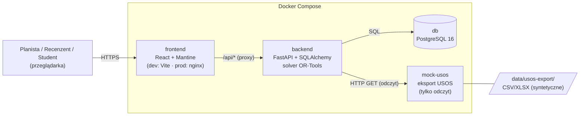
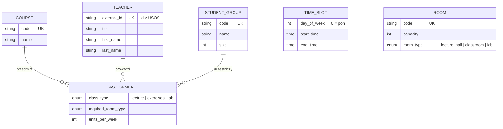

# Architektura (D-04, wersja wstępna)

## Kontenery (C4, poziom II)

- Frontend wywołuje wyłącznie względne ścieżki `/api/*`; w dev przekierowuje je Vite,
  w produkcji nginx. Dzięki temu nie potrzebujemy CORS ani konfiguracji adresu API.
- Prawdziwe USOS API jest poza zakresem MVP. `mock-usos` udaje źródło eksportu – backend
  może pobrać z niego plik i przekazać go temu samemu parserowi co ręczny upload (FR-04).
- Solver działa w backendzie, w osobnym procesie z limitem czasu (FR-11).

## Model danych (stan początkowy)

Kod: [`backend/app/models/domain.py`](../backend/app/models/domain.py).

Do dodania w kolejnych zadaniach: użytkownicy i role (FR-01, FR-02), niedostępności
prowadzących (FR-08), wersje planu i przydziały zajęć do terminów i sal (FR-11, FR-15),
uwagi recenzentów (FR-16).
